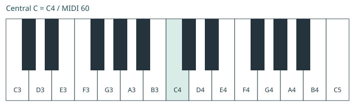

# 读前先弹：这本书怎样使用

本书面向刚开始学习五线谱、已经摸过键盘，却还难以连续读谱和双手配合的成人。目标是让一台琴同时承担旋律与伴奏，逐步弹完一首有起伏的歌；在此基础上，再学习乐队中如何分工、听拍与留白。

你需要一台能发出钢琴声音的键盘，能辨认其中央 C。带力度响应和延音踏板有助于后续练习；前面的读谱、节奏与合手练习先不用踏板。MIDI 可以帮助回看音高和时间，普通录音也可以完成本书大部分检查。

## 一章怎样学

先听本章谱例的双手示范，知道目标大致是什么声音；读解释，弄清每只手的任务；再按谱和操作说明练习。听示范时留一个具体问题，例如“左手什么时候重新开始”“这句在哪里结束”。不必把一段音乐每个细节都一次听懂。

每组谱例都有五线谱、分手播放，以及可下载的音频、MIDI 和 MusicXML。示范有一小节预备拍；6/8 谱例则数两个大拍。播放器可减速，MIDI 文件本身不含预备拍。声音是合成参考，不是钢琴家的示范录音。初学时先用它核对音高、时值和两手进入关系，音色与细腻的演奏处理还需要结合真实乐器聆听。

做完本章后，留一段短录音。下一次先自己弹一次，再决定复习哪里。当同一段已经熟悉，换一个小条件：从中间开始、改变两个旋律音，或换一种左手节奏。这能帮助你判断自己是否掌握了关系，而不只是记住一串动作。

## 三条学习线一起走

**读谱与演奏**负责把纸上的音、节奏和力度变成动作。**听觉与理解**负责听出方向、拍子、句子和和声关系。**音乐应用**负责把这些能力合成小曲，再迁移到喜欢的歌曲。每条线都需要练习；会说出和弦音，不自动等于能在音乐里及时弹出来。

第1–5章建立键盘定位、读谱、节奏和第一首双手小曲；第6–10章加入调、三和弦、伴奏、旋律层次与踏板；第11–14章扩展律动、小调、七和弦和独立学曲；第15章开始理解乐队角色，第16章整理练习与反馈。

本书采用连续学习顺序，但不把“一章”规定成“一天”或“一周”。已经会的内容可用章末任务检查后加快通过。遇到困难时，先降低当前任务的复杂度，不必从头重读整本书。

## 先完成音乐，再逐步丰富

你可以先弹喜欢歌曲的一段，再扩展到整曲；也可以选择简化版本，逐步增加伴奏密度。简化应保留重要旋律、乐句和关键和声关系，不能把遇到的黑键随意改成白键。转调时，整段音乐的音级关系需要对应地移动。

书中练习全部为原创，没有把它们冒称某首商业歌曲的简化版。目标曲《只为你拨云放晴》（ただ君に晴れ）的选谱入口与迁移步骤放在第14章；取得具体谱本后，才适合进一步判断那个版本的实际难点。

本版是可学习、可修订的第一版初稿。来源以伯克利官方手册为主要参考，OMT2 已读章节核对理论，正式课程大纲核对目标与顺序；少量国外公开讲义提供教学法补充。来源和本书教学设计的边界见附录。真人演奏、动作适配和试教仍需后续检查。

---

# 第1章　从键盘找到谱上的音

这一章先建立两个联系：看到一个音名，能找到相应琴键；看到谱上的一个位置，知道它与附近的音是什么关系。先在较小音域里练熟，再向两侧扩展。

## 用黑键分组找到 C 与 F

键盘的黑键按两个一组、三个一组重复。两个黑键左边紧邻的白键是 C，三个黑键左边紧邻的白键是 F。白键音名依次循环：C、D、E、F、G、A、B，再回到 C。

音名相同不代表音高相同。相邻两组的 C 相隔一个八度；本书用 C4 表示中央 C，用 C3 表示低一个八度的 C，用 C5 表示高一个八度的 C。不同软件的八度数字可能不同，遇到标成 C3 或 C5 的“中央 C”时，先核对实际音高；本书的 C4 对应 MIDI 音符编号60。

现在在琴上找三个不同音区的 C，再找各自旁边的 D、E。先看黑键分组再落手，慢慢减少从最左端数键的次数。弹过以后，闭眼听低、中央、高三个位置，感受它们的相对高度。

## 五线谱的高度表示什么

谱表有五条线和四个间。从下往上，相邻线与间依次对应相邻的字母音名。超出五线范围的音可以用加线继续表示。谱号告诉你这些位置对应哪些音；同一条线在不同谱号中可能表示不同音高。

| 谱号 | 五条线：从下往上 | 四个间：从下往上 |
|---|---|---|
| 高音谱号 | E4、G4、B4、D5、F5 | F4、A4、C5、E5 |
| 低音谱号 | G2、B2、D3、F3、A3 | A2、C3、E3、G3 |

钢琴常把高音谱表与低音谱表连成大谱表。中央 C 写在高音谱表下方的第一条加线上，也可以写在低音谱表上方的第一条加线上。这两种写法发出同一个音。

通常右手弹上方、左手弹下方，但谱号表示音高，并不强制规定用哪只手。后面读到换谱号时，也不必自动换手。

## 手指编号与第一段声音

两手都把拇指编号为1，食指2，中指3，无名指4，小指5。左手和右手的编号像镜像，不能从键盘左侧向右把两手都数成1到5。

坐在能方便触及当前音区的位置，肩、手臂与手腕保留活动余地。让指尖自然接触琴键，弹完一个音后感受何时松开。初学不需要靠持续绷紧手指来维持外形。

**E01 · 五个相邻音**

右手。中央 C 为 C4。先认黑键分组，再找到 C4。

[合成参考音频](assets/E01.wav) · [MIDI](assets/E01.mid) · [MusicXML](assets/E01.musicxml)

先用右手找到 C4–G4。谱中的数字是手指建议，这一次恰好可以用五指对应五个相邻白键。听示范后，先弹一遍上行，再弹回去。此时可以先关注音高，下一章再细读每种音符的长度。

## 本章练习

离开谱，找到 C4、F4、G4，再找到低一个八度的 C3。回到谱，指出 E01 的第一音、最高音和最后一音。然后选一个新的起点，例如 D4，说出它旁边的两个白键，并弹出来。

核对：E01 的第一音与最后一音都是 C4，最高音是 G4；D4 左边是 C4，右边是 E4。能找到这些音后，再试着只看谱面的上行与下行，而不逐个看音名表。

依据：S3《The Keyboard and the Grand Staff》《ASPN》；键盘图与练习为原创。

---

# 第2章　音在什么时候开始，保持多久

只弹对琴键，还不足以让旋律被认出来。节奏说明声音与安静在时间里怎样组织；这一章把找音的任务降到最低，集中练开始、保持、结束与休止。

## 拍子、小节与速度

跟着一首熟悉的歌轻轻点头或拍手，你通常能找到一串较均匀的时间点，这就是我们要维持的拍子。速度表示这串拍子有多快。谱上“♩=60”表示每分钟60个四分音符时值；在本章4/4练习中，也就是每分钟60拍。

4/4 的上方数字表示每小节四个四分音符拍，下方数字4表示以四分音符作为拍的单位。这是单拍子的读法；到了6/8，我们会把六个八分格组织成两个大拍，不能把所有拍号都套成同一种拍感。

## 以四分音符为一拍

| 记谱名称 | 本章4/4中的长度 | 数拍方法 |
|---|---|---|
| 全音符 | 四拍 | 在1开始，保持到下一小节1之前 |
| 二分音符 | 两拍 | 在1开始，占1、2两拍的时间 |
| 四分音符 | 一拍 | 相邻两个拍点之间的时间 |
| 八分音符 | 半拍 | 每拍平均分成两格 |

一个小节里所有时值合起来要符合拍号。4/4 可以写四个四分音符、两个二分音符，或许多别的组合。较长的音并不更响；音符的时值与力度是两种信息。

**E02 · 让休止也占时间**

右手单音；第二小节第一拍不弹，但继续数拍。

[合成参考音频](assets/E02.wav) · [MIDI](assets/E02.mid) · [MusicXML](assets/E02.musicxml)

先不弹琴，只拍谱中发声的时刻。第一小节拍“1、2、3”，第三拍的那个音占两拍，第四拍没有新起音。第二小节第一拍是休止：手可以不拍，口中与身体的拍子仍继续。

## 数到音的末端

第三小节两个二分音符分别在第1、3拍开始。最后一小节只有一个全音符，它占满四拍。按下后数“1、2、3、4”，再等到下一拍的边界才结束。很多初学者一数到4就放开，这会少掉最后一拍的大部分时间。

休止符也有长度。休止意味着在这一声部中按要求安静，并不意味着暂停整首曲子的时间。练习时，试着把第二小节的第一拍小声说成“空”，随后继续2、3、4。

## 八分格是以后合手的共同刻度

在每拍中间加一个口令“和”，得到“1和2和3和4和”。四分音符占两个格，八分音符占一个格。这个更细的刻度能帮助你安排落在拍子中间的声音，也能帮助两只手对齐。

先只在数字上拍手，再在每个数字和“和”上都拍手。保持数字之间的间隔不变；增加音的数量，不等于拍子本身变快。

## 本章练习与听觉检查

录下 E02，边回放边数四拍。听第二小节开头是否确实留出一拍，第三小节的两个音是否等长，结尾是否保持完整。

变化题：一个4/4小节先休止一拍，再弹一个四分音符、一个二分音符，能否填满小节？答案是可以，1＋1＋2＝4；起音在第2、3拍。先拍出来，再在 C4 上弹出来。

依据：S1第23–28页；S3《Notating Rhythm》《Simple Meter and Time Signatures》。本章按4/4限定时值与拍的对应关系。

---

# 第3章　让眼睛读到下一步

认谱刚开始慢是正常的。我们要把“每个音都重新数一次线与间”，逐渐变成“从已知位置读方向和距离”。需要精确定位的音仍然要确认，方向判断不能代替音高。

## 先确定位置，再读关系

高音谱表可以先记住 G4 所在的第二条线，以及 C4 所在的下加线；低音谱表先记 F3 所在的第四条线，以及 C4 的上加线。它们是定位点，不是全部需要背的音。遇到新音时，从附近已知位置沿线、间逐步移动。

从线到紧邻的间，或从间到紧邻的线，是相邻字母音名的进行。C到D、E到F都是这种级进，但琴键上的半音距离不一定相同。间到下一个间，或线到下一条线，中间隔过一个字母音名，例如 C到E，是三度的字母距离。

**E03 · 顺着方向读**

先从已知的 C4 找方向；第一个跳进是 E4 到 G4。

[合成参考音频](assets/E03.wav) · [MIDI](assets/E03.mid) · [MusicXML](assets/E03.musicxml)

先找到第一音 C4，再看轮廓：上、上、跳上，随后连续下行。第一小节 E4 到 G4 中间隔过 F4。弹的时候仍要读出实际音高，不能只凭“看起来上去”随便换到较高琴键。

## 把节奏和音高分别准备，再合在一起

一段新谱开始前，先看谱号、拍号、调号、第一音、最高最低音和明显的换手位。然后用手拍节奏；再慢速找音；最后把两件事合起来。准备的时间是读谱的一部分，并不要求看到谱就立刻开弹。

一边弹一边只盯着正在按的那个音，来不及准备下一步。可以先在两音短组中练习：第一个音开始后，视线去看下一个音，手指继续完成当前时值。逐渐扩展到能提前看懂一个小动机，而不强求一次看很远。

当手位不变时，尽量通过触觉确认琴键；需要较大移动时，有目的地看一下落点，再回到谱上。完全不看键盘不是初学阶段的硬性要求。

## 低音谱表也能唱旋律

**E04 · 左手自己的旋律**

只弹左手；低音谱表不等于只能弹伴奏。

[合成参考音频](assets/E04.wav) · [MIDI](assets/E04.mid) · [MusicXML](assets/E04.musicxml)

E04 由左手独立弹奏。找到 C3，按建议指法开始，听见和右手练习相似的方向。谱号决定你读到的音高；左右手应各自获得读谱经验，不能长期只让左手记固定伴奏形状。

## 熟曲练习与陌生短谱

熟曲允许你慢慢解决指法、音色与连接；陌生短谱则检查能否读懂新材料。两种任务都保留。读新谱时选择比正在精练的曲目更简单的材料，先准备，再以可维持的拍子向前读。

遇到错误，可以先完成短句，再回头定位原因；精练时则把错误点单独处理。一次读新谱不必同时承担“绝不停止”和“每个细节完美”的全部要求。先把任务范围缩小到一个可观察的问题。

## 本章练习

给 E03 每小节标出起点、最高点与最低点；弹之前说出有哪些级进、有哪些跳进。把第二小节改为 F4–D4–E4–C4，保持每音一拍，再读一遍。新句的字母距离分别是下三度、上二度、下三度。

随后读 E04，但暂时盖住指法数字，先选出自己能顺畅使用的指法，再对照建议。若音都能认出、却总来不及连续弹，下一轮先降低节奏和移动要求，而不是只增加音名默写。

依据：S3《The Keyboard and the Grand Staff》《Intervals》；《Berklee Keyboard Method》课程第1–5课用于覆盖核对；Bill Hilton讲义第2–4课与补充 A 用作练习组织参考。

---

# 第4章　第一次把双手放在同一条时间线上

这一章的目标，是让右手改变音高时，左手仍按自己的时值保持。先会分别弹两行谱，会让合手更容易开始；真正的合手任务还需要练习两手之间的时间关系。

## 先听两只手各在做什么

听 E05 的双手示范，再分别听右手和左手。你应能听出：右手多数时候每拍有一个新音，左手则每小节只开始一个音。左手音在延续，和左手不断重弹，是不同的声音。

**E05 · 长低音托住旋律**

左手每小节只开始一次，并保持四拍；右手音变时，左手不跟着重弹。

[合成参考音频](assets/E05.wav) · [MIDI](assets/E05.mid) · [MusicXML](assets/E05.musicxml)

这组练习的右手都在 C4–G4，建议从拇指到小指依次对应这五个音。左手可把小指放 C3、食指放 F3、拇指放 G3。准备好位置，再开始数拍；手指编号不是音高名称，之后换手位时，同一个手指会弹其他音。

## 把第一小节拆成四个时刻

| 数到哪里 | 右手 | 左手 |
|---|---|---|
| 1 | 开始 C4 | 同时开始 C3 |
| 2 | 改弹 D4 | C3 继续保持 |
| 3 | 改弹 E4 | C3 继续保持 |
| 4 | 改弹 G4 | C3 继续保持 |
| 下一小节 1 | 开始 F4 | 换成 F3 |

注意，第一小节左手全音符占满四拍，包含从第4拍开始到下一小节第1拍之间的时间。不要一数到“4”就松开。这里也不用踏板帮忙：先让手指自己完成保持，才容易知道问题出在哪里。

## 从两拍开始合，再接完整小节

先用右手弹第一小节，边弹边数“1、2、3、4”。然后只弹左手 C3，数完四拍，移到 F3。确认两行的音高和时值后，合第一拍；保持左手，让右手接上第二拍。能做到时，继续到第三、第四拍。

每次回到开头，留一点准备时间。目标是把动作接起来，不能为了勉强跟上示范而省略准备。示范速度只是参考，播放器的慢速选项可降低负担；如果仍需要停下来找音，就先离开固定速度，确定动作后再恢复均匀的拍子。

接下来练第1小节最后两拍到第2小节前两拍。这里同时发生右手向下、左手换音，是一个新的任务。只练每小节的开头，很容易留下小节线处的停顿。最后依次连接第1–2、第2–3、第3–4小节，再弹完整四小节。

分手练习和合手练习可以来回切换。若左手换错音，单独找左手位置；若两手各自正确、一起就互相带动，回到表格中的共同时间点。无需等单手练到很快才开始慢速合手。

## 换一种关系：两手交替

E06 的前三小节按“左、右、左、右”轮流发声。先不用琴，用左右手轻拍桌面并数四拍，再到键盘上找音。最后一小节改为双手同时进入，别把交替惯性带到结尾。

**E06 · 两手交替进入**

前三小节按左、右、左、右交替；最后一小节双手同时进入。第二小节右手需移动手位。

[合成参考音频](assets/E06.wav) · [MIDI](assets/E06.mid) · [MusicXML](assets/E06.musicxml)

第二小节右手到 A4，超过上一练习固定的五指范围。可以在这一小节开始前，把右手移动到 E4–B4 一带，再用适合的手指弹 F4、A4；第三小节开始前移回较低位置。本练习已有休止可供准备，不需要把手固定在原处勉强伸展。

## 常见卡点与处理

右手每弹一次，左手就重弹一次：先把左手音按下，再单独观察右手换音；只做两拍，确认左手没有重新触键后扩展。

左手换音时右手停住：提前找到下一小节左手落点，集中练跨小节的短段。手的移动可以提前准备，声音的开始仍要落在正确的拍上。

弹着弹着不再数拍：先用更简单的音型恢复连续脉搏，也可暂时只拍两手节奏。不要同时增加音高难度、节奏难度和速度。

## 本章练习与下一次复习

今天选 E05 的两个相邻小节，录一遍，听左手有没有被右手带着重弹，以及小节线处有没有停顿。下一次练习先弹一次，记录最先出现的问题，再针对那个连接点练习。

变化任务：把右手第一小节改成 E4–D4–C4–G4，每音一拍，左手保持不变。如果原练习熟练、换了右手就失去左手保持，说明两手关系仍需练习；这条变化题正好提供新的材料。

本章借鉴 Berklee 钢琴手册第5–10页的双手准备与独立训练，以及 Bill Hilton 补充讲义 A 第2–3页的分手、合手交替与基础复习建议。具体谱例、时间表和练习梯度为本书原创设计，尚未经过真人试教。

---

# 第5章　把八小节弹成一首小曲

现在把前面的小任务连接成音乐。第一首完整小曲只有八小节，右手保持在 C4–G4 的范围，左手使用长低音。我们开始注意重复、问答、句子和结束。

## 先听全貌

**E07 · 小曲：一步一步**

八小节原创小曲。右手范围 C4–G4；建议五指对应这五个音。全曲先不用踏板。

[合成参考音频](assets/E07.wav) · [MIDI](assets/E07.mid) · [MusicXML](assets/E07.musicxml)

先听一遍，不急着弹。然后听第二遍，轻轻数拍，试着在第4小节与第8小节末尾感受停顿的可能。四小节分句是这首练习的设计，不是所有音乐都必须遵守的句长。

右手前四小节向前展开，后四小节作回应，最后停在 C4；左手结尾回到 C3。你可以先唱出右手的大致方向，再到键盘核对。不会唱准时，把短句缩小到两个音，并给自己一个参考音；听觉练习也需要合适的起点。

## 读懂当前这张谱

全曲4/4，每小节四拍。右手第2、4小节出现二分音符，第8小节是全音符。左手每小节只有一个全音符。左手第3、4小节连续两次写 C3，意味着两小节开头都要重新触键；同音并不自动连成一个八拍长音。

这里没有要求踏板。先用手指保持应有的时值，听见哪些音连接、哪些音重新开始。右手可用1–5指对应 C4–G4；左手继续准备 C3、F3、G3 三个位置。

## 练句子，也练句子之间的路

先读第1–2小节，再读第3–4小节，之后连接四小节。后半段同样处理。每段合手前，分别确认左右手；合手遇到问题，回到第4章的共同时间点。

找到停顿处后，圈出它前后的一两个拍子。比如第2小节最后的 D4 接第3小节 E4，右手向上走，左手从 F3 换到 C3。把这个接口练清楚，比每次从第1小节重来更直接。

最后练第4小节到第5小节的跨句连接。句子之间可以有呼吸感，但本谱没有写额外休止；先维持完整拍子，再在熟悉后尝试轻微的句尾收束。表达处理不能建立在不知道下一音在哪里的被迫停顿上。

## 给旋律一个方向

先把右手单独弹得连贯，听每个乐句的起、承、转、落。选出你想突出的一两个位置，稍作强调；不要每个音都一样用力，也不要把每个高音都弹得很重。

合手时，左手的任务是托住右手。先弹左手，再让右手加入，听旋律是否容易被跟唱。若低音盖住旋律，先减少左手的力度，保留清楚的起音；不是所有情况都需要把右手越弹越响。

## 第一份阶段录音

给自己四拍预备，弹完八小节并保持结尾。回听时只记录三个问题：时间是否连贯，长音是否足够，旋律是否听得清楚。选最明显的一项，针对一个短段改善，再录一次比较。

下一次练习，先从第5小节开始；再从第3小节开始。能从不同句子进入，有助于摆脱“忘了开头以后就整首接不上”的情况。此处仍可看谱，背谱不是完成这首小曲的必要条件。

核对题：第8小节全音符是否在数到4时立刻结束？否，它要保持完整第四拍的时间。第3、4小节左手相同音是否只按一次？否，两小节各有一次新起音。

依据：S2第19–30页的练习目标、困难点隔离与声音控制；S3《Melody and Phrasing》。作品与分段方案为原创。

---

# 第6章　调、音阶与键盘上的黑键

调性音乐常让某个音听起来像可以安定下来的中心，这个音叫主音。音阶把一组常用音按高低排列，帮助我们熟悉音高关系；音阶不是一首歌的全部，也不能单凭使用了哪些音就永远确定它的主音。

## 大调的全半音结构

键盘上相邻的两个键，不论黑白，相隔半音。两个半音合成全音。E到F、B到C之间没有黑键，是半音；C到D之间夹着一个黑键，是全音。

从 C 开始，按“全、全、半、全、全、全、半”向上走，得到 C、D、E、F、G、A、B、C。这是 C 大调音阶。一个八度里的音级依次叫第1到第7级，上方的 C 又是第1级。

**E08 · C 大调的一次换指**

同音重复处重新触键。音阶指法是建议，移动应平顺。

[合成参考音频](assets/E08.wav) · [MIDI](assets/E08.mid) · [MusicXML](assets/E08.musicxml)

右手从 C4 上行，前三音用1、2、3指，再让拇指移动到 F4，继续1、2、3、4、5。把移动做成连续准备，不要等到拇指最后一刻才硬挤过去。先慢速看清路径；谱例在最高音重复一次，再下行，重复处要重新触键。

音阶训练要服务于读谱、手位移动和旋律。弹完以后，用这些音编一个四拍短句，再弹一个回应。只跑完整音阶而从不用它读旋律，应用能力仍然需要另练。

## G 大调为什么有 F♯

从 G 开始保持同样的全半音结构，需要 G、A、B、C、D、E、F♯、G。第7级到主音之间要保留半音，所以 F 需要升高。

升号 ♯ 表示把所写的音提高半音，降号 ♭ 表示降低半音，还原号 ♮ 撤销适用的升降。它们不表示“永远改成黑键”；升 E 会到 F 的同一琴键，降 C 会到 B 的同一琴键。

**E09 · G 大调与 F♯**

调号使本谱所有 F 默认升高；本例从 G4 开始。

[合成参考音频](assets/E09.wav) · [MIDI](assets/E09.mid) · [MusicXML](assets/E09.musicxml)

谱号后面的一枚升号是调号，它使本谱各八度的 F 默认成为 F♯，直到调号改变或出现相应临时记号。临时记号则在通常现代记谱中影响同一小节内同音高位置的后续音；遇到跨小节延音线等写法，要按具体记谱读，不能机械地忽略延续关系。

## F 大调为什么有 B♭

从 F 按相同结构上行，得到 F、G、A、B♭、C、D、E、F。这里用 B♭，而不是随便换成 A♯，因为这条音阶的字母音名应逐级排列；音高相同的两种拼写，在和声和读谱中可能有不同含义。

**E10 · F 大调与 B♭**

F 大调右手上行先用 4 指弹 B♭，再把拇指移动到 C。

[合成参考音频](assets/E10.wav) · [MIDI](assets/E10.mid) · [MusicXML](assets/E10.musicxml)

右手先用4指弹 B♭，再把拇指移动到 C5。F 大调的指法与 C 大调不同，不能把一条固定指法套给所有起点。

## 把熟悉短句移到新调

移调保留音乐的音程与音级关系，同时整体改变音高位置。先试 E05 的第一小节：在 C 大调是第1、2、3、5级；移到 G 大调就是 G、A、B、D。

**E24 · 把短句移到 G 大调**

E05 整体上移纯五度。听相同的音级关系；不是只按相同白键位置。

[合成参考音频](assets/E24.wav) · [MIDI](assets/E24.mid) · [MusicXML](assets/E24.musicxml)

E24 把 E05 整体向上移了纯五度。两手都移动，节奏保持不变。你不必先会所有调才能弹喜欢的歌；先熟悉当前曲目需要的调，再逐渐扩展，保留清楚的调号阅读。

核对题：G 大调第7级是什么？F♯。F 大调第4级是什么？B♭。C 大调第1、3、5级移到 F 大调是什么？F、A、C。

依据：S3《Half and Whole Steps》《Major Scales》《ASPN》；S2练习方法；《Berklee Keyboard Method》第4、6课用于覆盖核对。具体手指是本例建议，不是普遍适用的动作处方。

---

# 第7章　把音组合成三和弦

旋律一个音接一个音地展开，和声让同时或连续响起的音形成背景。三和弦是理解和声的一种基本结构；学它时既要认音，也要听不同组合带来的变化。

## 音程先看字母，再看半音

音程表示两个音的距离。先把起点也算作1：C到E是 C、D、E，属于三度；C到G是五度。再数半音，判断性质：C到E四个半音，是大三度；C到E♭三个半音，是小三度。

只数琴键半音还不够。C到D♯与C到E♭在十二平均律钢琴上听起来相同，但字母距离不同，前者是增二度，后者是小三度。和弦音的拼写要表达它在结构里的位置。

## 根音、三音、五音

把根音及其上方的三度音、五度音组合起来，得到三和弦。以 C 为根音，大三和弦是 C–E–G。这里“根音”说的是和弦的结构基础，暂时不要把它和整首歌的主音、当前最低的低音混为一谈。

| 性质 | 根音上方的音程 | C 根音示例 | 常见符号 |
|---|---|---|---|
| 大三和弦 | 大三度、纯五度 | C–E–G | C |
| 小三和弦 | 小三度、纯五度 | C–E♭–G | Cm |
| 减三和弦 | 小三度、减五度 | C–E♭–G♭ | Cdim、C° |
| 增三和弦 | 大三度、增五度 | C–E–G♯ | Caug、C+ |

**E11 · 同根音的四种三和弦**

听比较时每种单独停留；这不是要求背诵的和声进行。

[合成参考音频](assets/E11.wav) · [MIDI](assets/E11.mid) · [MusicXML](assets/E11.musicxml)

听每种组合，再分开弹三个音，最后一起弹。最初把根音保持一致，有助于比较其他音改变了什么。大调与小调、大和弦与小和弦也不能简单等同于两种固定情绪；声音的情境还包括旋律、节奏、音区与前后关系。

右手弹紧密三音时，可以先尝试1、3、5指，但要按具体键位调整。三个音需要在共同的时间点开始，不能为了把小指压下去而让其余音先走。先练两个音同步，再加入第三个音。

## 在 C 大调里逐级建立和弦

只用 C 大调的音，从每个音级隔一个取一个，可以得到：C、Dm、Em、F、G、Am、Bdim。性质由实际音程决定，不是每一级都套成同样形状。

罗马数字用来表示相对于调的级数。本书采用大写表示大三和弦，小写表示小三和弦，减三和弦加 °：I、ii、iii、IV、V、vi、vii°。有些流行谱采用全大写级数另标性质，阅读时先看它的记号约定。

I、IV、V 在 C 大调是 C、F、G；移到 G 大调，就变成 G、C、D。记级数让你看见关系，记绝对和弦名让你知道当前要弹什么，两种读法相互补充。

## 本章练习

写出 Dm、F、G、Am 的音，再慢慢在琴上弹。答案依次是 D–F–A、F–A–C、G–B–D、A–C–E。留意 Dm 的三音是 F，不是 F♯。

闭眼听 E11 中任意两种和弦，先描述它们哪里不同，再看符号核对。可以借助听起来较熟悉的音作为参照；本章不要求听一次就给任何和弦命名。

依据：S3《Intervals》《Triads》《Roman Numerals》；S1和声节选与S2流行和弦节选。例子与初学练习顺序为原创。

---

# 第8章　让和弦连接，也分清低音与根音

知道一个和弦有哪些音以后，还要决定它们放在哪个音区、怎样分配到两只手，以及下一和弦怎样接过来。这些具体安排叫声部配置；各条声部从一个音走到下一音的过程叫声部进行或声部连接。

## 不必每次整块平移

**E12 · 保留共同音的连接**

右手改变排列，左手始终弹相应根音。整体四个和弦都处于原位。

[合成参考音频](assets/E12.wav) · [MIDI](assets/E12.mid) · [MusicXML](assets/E12.musicxml)

先弹右手：C4–E4–G4，接 C4–F4–A4，再接 B3–D4–G4，最后回到 C4–E4–G4。第1到第2小节保留 C4，另外两个音各上行一步；最后一个和弦回到开头的位置。

把右手最低、中间、最高的音分别连成线，你会发现每条线都可以单独读。保留共同音、选择较近落点，有助于减少许多不必要的跳跃。不过，音乐里也需要有意的跳进和音区变化；“所有声部永远走最近”不是普遍规则。

先分开练两次相邻和弦，提前准备下一组位置，再接左手根音。跨小节移动时，上一和弦仍按它的时值结束；新和弦在新拍点同时开始。

## 右手排列变化，不一定改变整体转位

E12 的左手依次弹 C、F、G、C，都是各自和弦的根音。右手有时把三音或五音放在自己的最下面，但整个双手和声的最低音仍是根音，所以整体和弦仍是原位。

判断整体转位，看的是整个和声里最低的和弦音。根音在最低是原位，三音在最低是第一转位，五音在最低是第二转位。七和弦还有七音在最低的第三转位。

**E13 · 低音决定整体转位**

根音始终是 C；低音依次为 C、E、G、C。

[合成参考音频](assets/E13.wav) · [MIDI](assets/E13.mid) · [MusicXML](assets/E13.musicxml)

这里右手三音完全不变，低音变成 C3、E3、G3、C3。根音始终是 C；只有低音与整体转位发生改变。C/E 表示 C 和弦、E 在低音；C/G 同理。

## 三个词各回答一个问题

| 名称 | 回答的问题 | C/E 在 C 大调语境中的例子 |
|---|---|---|
| 主音 | 这段音乐围绕哪个调性中心？ | 若中心为 C，主音是 C |
| 根音 | 这个和弦的结构以哪个音为基础？ | C 和弦的根音是 C |
| 低音 | 此刻整个和声最低的音是什么？ | 低音是 E |

斜线和弦的斜线后面也可能是非和弦音。因此，看见斜线不能自动判定成某一种转位，先检查实际音的组成。

## 独奏与有贝斯的合奏

独奏时，你需要安排低音与旋律之间的支撑。合奏中如果贝斯已经弹根音，键盘可以减少重复低音，并把注意力放到中音区的和声音上。省略根音是否合适，取决于整个编制听起来是否清楚，不是把根音删掉就一定更高级。

低音区同时堆很多紧密和弦音，可能让声音不清楚。先减少音数，或把部分音移高一个八度，再听比较。具体界限取决于音色、响度和其他乐器，不能用一条固定音高线概括所有情况。

## 本章练习

只弹 E13 的右手，再加入不同低音，听相同三音在不同最低音之上如何变化。之后用 E12 做一次比较：右手采用谱面排列，与每次都把根音放在右手最下面，听连接哪里更顺、哪里更跳。

核对：右手 E4–G4–C5，左手 C3，整体是否第一转位？不是，最低音 C3 是根音，整体仍为原位；右手本身采用了 E–G–C 的排列。

依据：S2第77–86页；S3《Inversion》《Jazz Voicings》《Chord Symbols》。原始资料中的转位与排列歧义在研究记录中单列，本书按整体最低音判断整体转位。

---

# 第9章　同一段旋律，三种伴奏

独奏时，右手让人听见歌的旋律，左手提供低音、和声与节奏。伴奏的音数和密度可以改变；选择哪一种，要看它能否支撑旋律，以及你能否稳定地完成两手关系。

## 第一层：两音和声

**E14 · 旋律与两音和声**

左手采用根音与三音，省略五音；右手旋律应清楚地浮在上面。

[合成参考音频](assets/E14.wav) · [MIDI](assets/E14.mid) · [MusicXML](assets/E14.musicxml)

左手每小节同时弹根音与三音，省略五音，右手弹旋律。C3–E3 已经说明 C 大和弦的重要性质；不是每一拍都必须把所有和弦音凑齐。谱上写 C、F、G、C，指示本练习的和声安排，实际配置由谱面给出。

先单独弹左手四小节，听每个新和弦的开始；再只唱旋律，让左手托住它；最后换成右手演奏。先准备和弦的整体落点，避免根音与三音先后落下。

把右手声音稍微放到前面，左手稍轻。听回放时，试着不看谱跟唱旋律；如果只听见左手的一团声音，先降低左手响度或减少音数。

## 第二层：把和弦摊开到时间里

**E15 · 四分音符分解伴奏**

左手每小节音型为根—五—三—五；F2 在 C3 下方，先确认八度。

[合成参考音频](assets/E15.wav) · [MIDI](assets/E15.mid) · [MusicXML](assets/E15.musicxml)

右手旋律不变，左手每拍一个音，按“根、五、三、五”的顺序排列。第一小节 C3–G3–E3–G3，仍取自 C 和弦。分解和弦改变了织体，没有把和弦本身自动换成另一种性质。

左手先认准每小节的范围。第二小节是 F2–C3–A2–C3，位置比第一小节低；第三小节是 G2–D3–B2–D3。确认八度，别把相同字母随意换到另一个音区。

一种可尝试的左手指法是5–1–3–1。用较轻的移动准备拇指落点，不必把整个跨度一直撑开。其他指法也可以，只要时值与连接清楚、动作方便重复。

合手时先圈每拍的对齐点。右手的二分音符保持两拍，左手在下面继续走，回到第4章学过的“一个声部保持、另一个声部变化”。

## 第三层：一拍两个伴奏音

**E16 · 八分音符分解伴奏**

每拍两格。增加密度后仍保持旋律突出，不急于提高速度。

[合成参考音频](assets/E16.wav) · [MIDI](assets/E16.mid) · [MusicXML](assets/E16.musicxml)

同一左手音型在每小节重复两次，每音改为八分音符，整小节仍是四拍。先数“1和2和3和4和”，把右手的起音标在相应格上。密度提高以后，仍要听得见上方旋律。

这三种版本可以长期并用。主歌想保持疏朗，可以用较少音；需要推动时，可以增加伴奏活动。实际编配还受旋律节奏、音区、音色和段落影响，不能把“副歌一定八分分解”当作规定。

## 改编时保留哪些东西

先保留旋律的重要音与节奏、乐句的长度、关键低音与和声变化。若左手太忙，可以减少重复音或将分解改为长和弦；如果谱里明确写了特殊低音，不要随意全部改成根音。

伴奏改动以后，要重新听旋律与低音的关系。遇到不属于当前和弦的旋律音，先看它在句子中如何到来、如何离开；经过音、邻音和延留都可能有音乐意义，不必一看到“非和弦音”就修改旋律。

## 本章练习

把 E14–E16 依次弹出来，选一个当前最稳定的版本录音。然后做一个四小节小编配：前两小节用两音长和声，后两小节用四分分解，保持右手不变。听密度变化是否清楚、接口是否仍在拍上。

核对：第一小节左手 C3–G3–E3–G3 是否四个不同和弦？不是，是同一 C 和弦的分解。八分音符版本是否必须更快？不是，每拍有更多音，但拍速可以相同或更慢。

依据：S2第45–55、77–86页；S3《Embellishing Tones》《Texture in Pop Music》；《Berklee Keyboard Method》第6–9课用于覆盖核对。三层连续练习为原创编排。

---

# 第10章　让旋律唱出来

音高和节奏正确，是表达的基础。接下来考虑哪些音更重要、怎样连接、哪里呼吸，以及踏板怎样影响清晰度。每次只改变一两个因素，听出它们具体带来了什么。

## 两手平衡与旋律方向

回到 E07 或 E14，只弹右手，先唱出一句。用自然呼吸寻找句子走向，选择你认为重要的位置，试着稍微走向它、再收回来。这个位置可能与音高、节奏、歌词或和声有关，不必总在小节第一拍。

接左手时，先保留右手原有的方向，再减少左手的干扰。让左手轻一些不等于含糊地擦过琴键；它仍需要清楚、稳定的起音。两手用不同力度本身就是一项配合任务，可以先把左手减少成单低音练习。

响度记号从较轻到较响常见有 pp、p、mp、mf、f、ff。它们是相对关系，受乐器、空间与风格影响，不对应一个固定 MIDI 力度值。渐强与渐弱描述一段过程，也不要求每个音机械地比前一音多或少相同的数值。

## 连奏、断开与句末

连奏要让音与音听起来连接；断奏或跳音会缩短音之间的连接感。它们与拍速不同：一个较短的四分音符触键，仍占据它所在的一拍位置，下一音不能因此提前。

先以四个等长四分音符尝试连贯与较短两种奏法。保持起音间隔相同，只改变每音保留的时间。然后回到旋律，依据乐句与谱上标记使用，而不是让所有音都用同一种断开程度。

乐句结束时，可以在保持拍子基本连贯的前提下，让力度或音尾稍作收束。本书基础示范主要帮助核对音高、时值与两手响度关系；你设计的句子处理需要另作录音比较。

## 延音踏板先从清晰度学起

延音踏板通常在右侧。踩下时，松开手指后的许多音仍能继续衰减；抬起后，它们的延续会改变。数码钢琴的具体响应取决于乐器与踏板，先在自己的琴上试一个单音，听“按住键”“松键但踩踏板”“松键并抬踏板”的区别。

踏板不能代替读清楚时值。先不用踏板弹对谱，再决定哪些声音需要延续。在换和声时保留太多前一和弦的音，可能变混；同一和弦内经过音较多，也可能需要更频繁地换踏板或减少踏板。

**E17 · 换和声时换踏板**

有踏板示范：每小节开始后稍晚踩下，下一小节开始前抬起。本例是入门分段练习，非通用踏板公式。

[合成参考音频](assets/E17.wav) · [MIDI](assets/E17.mid) · [MusicXML](assets/E17.musicxml)

E17 是入门分段练习：每小节开始后稍晚踩下，小节结束前先抬起，再进入下一和弦。这会留下一个可辨认的清理点，先帮助手脚建立关系。熟悉后可另外练习切分踏板：新和弦按下后迅速抬起旧踏板，再踩下，使新声音连接而旧声音清掉。两种方法不要在最初一次练习中混做。

本谱只把这个换踏板方案写在说明中，未逐点印踏板线。配套声音与 MIDI 采用说明中的分段方案；其他不标踏板的练习默认不使用踏板。没有踏板时，可跳过这项，继续用手指和较疏织体练习句子。

## 本章练习

录下同一四小节的无踏板、分段踏板两个版本，听小节连接和低音清晰度。再保持踏板方案不变，只改变两手力度比例，比较哪一版更容易听出旋律。

检查的依据是可听变化：旋律能否被跟唱、休止是否被踏板填满、换和声后是否还残留明显不需要的声音。别用“踏板踩得多”判断演奏更成熟。

依据：S2第19–30页的力度与声音控制；S3记谱与织体章节。踏板分段方案是本书的入门设计；不同乐器与曲目需要具体调整。

---

# 第11章　切分、连音线与6/8

流行旋律常在拍子中间开始，或把一个音延续经过下一个拍点。先有稳定的拍感，再把声音放到更细的格子里，能让复杂节奏变成可以逐步安排的动作。

## 连音线把同一个音延长

延音线连接两个同音高的音符，把它们的时值相加，第二个音头不重新触键。连接不同音高的一条弧线通常是连奏或乐句线，要按乐句连续弹不同音；两种线的作用不同。

**E18 · 切分与连音线**

连音线连接同音，右手 E4 在第一小节第二拍不重新弹；第三小节 D4 同理。

[合成参考音频](assets/E18.wav) · [MIDI](assets/E18.mid) · [MusicXML](assets/E18.musicxml)

第一小节右手先休止半拍，在“1和”的“和”上开始 E4。它的八分音符和下一拍的四分音符用延音线连在一起，总共保持一拍半，到第3拍再弹 G4。第二拍左手开始 G3，但右手 E4 不重新开始。

| 八分格 | 1 | 和 | 2 | 和 | 3 | 和 | 4 | 和 |
|---|---|---|---|---|---|---|---|---|
| 右手 | 空 | E4开始 | E4延续 | E4延续 | G4开始 | 延续 | E4开始 | 延续 |
| 左手 | C3开始 | 延续 | G3开始 | 延续 | C3开始 | 延续 | G3开始 | 延续 |

先只数格，再拍右手节奏，然后拍左手拍点。两手关系清楚后才加入音高。第三小节采用相似关系，右手换成 D4 与 F4。

## 切分要靠拍子听得出来

常见切分会让原本较弱位置开始的音得到强调，或延续经过较强位置。听者仍能感到基础拍子，才能听出声音与它的错位。练习时不要为了“弹得有感觉”而把预定格子模糊掉。

先用节拍器或稳定伴奏确认落点，再暂时关掉它，保持同样脉搏。能在慢速下准确进入后，再尝试更接近音乐语境的响度与句子处理。单独的节奏格是分析工具，最终仍要回到完整声音。

## 6/8：每个大拍分三份

**E19 · 6/8 的两个大拍**

附点四分音符 = 60。每大拍三格；预备数两个大拍。

[合成参考音频](assets/E19.wav) · [MIDI](assets/E19.mid) · [MusicXML](assets/E19.musicxml)

6/8 每小节有六个八分音符单位，常分成两组，每组三个，形成两个大拍。可以数“1-la-li、2-la-li”。本例附点四分音符=60，即每分钟60个大拍；每个大拍容纳三个等分八分音符。

附点把原时值增加一半：附点四分音符等于一个四分音符加一个八分音符，所以占三个八分格。E19 左手每小节两个附点四分音符，正好分别落在两个大拍开头；右手前三小节每格一音，结尾保持整小节。

不能只看6/8和3/4总时值同样等于六个八分格，就认定它们有相同拍感。常见3/4是三个大拍、每拍分两格；常见6/8是两个大拍、每拍分三格。实际音乐也会出现混合或重新分组，要结合听感与记谱判断。

## 本章练习

把 E18 的右手节奏在一个音上拍出来，再说出哪些拍只有左手新起音。随后只弹 E19 的左手，身体感受两个大拍，再加右手。

核对：E18 第一小节右手第二拍是否要重弹 E4？不重弹。E19 最后一小节的附点二分音符长多少？六个八分格，或两个附点四分音符大拍。

依据：S3《Notating Rhythm》《Compound Meters and Time Signatures》《Rhythm and Meter in Pop Music》。本章先处理常见分组，不用固定口令概括所有节奏风格。

---

# 第12章　在小调里听见去向

小调不只是把一段旋律弹得轻一些。它涉及主音周围的音高与和声关系。先从 A 小调开始，利用熟悉的白键建立主音感，再听某些音为什么会在特定和声中改变。

## A 自然小调与 C 大调

A 自然小调的音是 A、B、C、D、E、F、G、A，和 C 大调使用相同的白键集合，但主音不同。先弹 A–C–E，再停回 A；再弹 C–E–G，停回 C，听不同中心带来的关系。

一首曲子用了这些白键，不足以单独证明它一定是 A 小调或 C 大调。旋律重心、低音、和声进行、停顿与结束都能参与判断。有些流行段落的调性中心本来就不十分明确，分析时可以保留不确定性。

## E7 中为什么出现 G♯

在 A 小调中，E–G♯–B–D 构成 E7。G♯ 距上方 A 半音，常有趋向 A 的作用，配合 E7 到 Am，能形成较明确的属到主的去向。

把 A 自然小调的第7级 G 提高半音，得到 A 和声小调：A、B、C、D、E、F、G♯、A。这种音阶概括了常见的小调和声用音，但实际小调音乐会根据旋律与和声同时使用不同形式的第6、7级。不是一选“小调”，整曲每个 G 都必须升高。

**E20 · 小调小曲：晚灯**

第 3 小节 E7 的七音由右手 D5 提供；第 7 小节同样如此。G♯ 用于通向 A 的属和声。

[合成参考音频](assets/E20.wav) · [MIDI](assets/E20.mid) · [MusicXML](assets/E20.musicxml)

先只听左手，再听双手。第3与第7小节左手出现 G♯；右手在这些小节也提供 D 音，使整个织体包含 E7 的七音。下一小节回到 Am，听这个连接。

## 从长低音开始，再加分解

这首八小节小曲的旋律范围比第一首更大。先在每小节开头找好右手位置，必要时移动手位。比如第1小节 A4–C5–E5–C5 可以尝试1–2–4–2指，第2小节再根据 D5–C5–B4 的下行调整。指法先以顺畅连接为目标，确定后尽量保持稳定。

左手先改成每小节一个长根音：A、D、E、A、D、A、E、A。右手能与它配合后，再恢复谱中每拍一音的伴奏。这个简化版本仍保留低音去向，但暂时不呈现所有和弦音，听感会比完整示范更疏。

## 先理解组成，再谈功能

Am 的音是 A–C–E，Dm 是 D–F–A。E大三和弦使用 G♯，Em 使用 G；两者不能只看根音相同就互换。某处应该用哪个，需要看实际旋律、和声与版本。

在本练习的明确 A 小调语境中，可以把 Am、Dm、E7 分别理解为 i、iv、V7。功能分析帮助解释这里的去向；遇到其他风格，仍要根据音乐重新判断，不能把每个大三和弦都贴成“属”。

## 本章练习

先弹 E7–Am，再把 E7 中的 G♯ 改成 G，比较 Em7–Am 的声音。两种连接都能成为音乐材料，但效果不同；本谱选择的是前一种，照谱演奏时应保留它。

写出 A 和声小调第6、7级，以及 E7 的四个音。答案是 F、G♯，以及 E–G♯–B–D。录音时听第3到4、第7到8小节是否连贯，不要因为遇到临时升号就暂停整段时间。

依据：S3《Minor Scales》《Seventh Chords》《Strengthening Endings with V7》《Fragile, Absent, and Emergent Tonics》。作品与练习为原创。

---

# 第13章　读懂七和弦与常见和弦符号

实际歌曲的和弦符号不只包含 C、F、G。学习七和弦，可以帮助你辨认更丰富的和声，也能理解为什么配置中有些音可以省略、有些音会明显改变性质。

## 在三和弦上再加一个七音

三和弦以根、三、五为基础；七和弦再加入根音上方的七度音。以 C 为根音，B 是大七度，B♭ 是小七度。这两个音一换，和弦性质也会改变。

| 符号 | 组成示例 | 名称 |
|---|---|---|
| Cmaj7、C△7 | C–E–G–B | 大七和弦 |
| C7 | C–E–G–B♭ | 属七和弦：大三和弦加小七度 |
| Cm7 | C–E♭–G–B♭ | 小七和弦 |
| Cm7♭5、Cø7 | C–E♭–G♭–B♭ | 半减七和弦 |

“属七”在这里首先是结构名称。它在常见调性语境中可以发挥属功能，但布鲁斯中的主和弦、下属和弦也可以采用这种结构；判断功能仍要看具体进行与风格。

**E21 · 听清七和弦性质**

四个和弦的性质比较，结合两手判断全部和弦音；不是通用的功能进行。

[合成参考音频](assets/E21.wav) · [MIDI](assets/E21.mid) · [MusicXML](assets/E21.musicxml)

本例用两只手共同组成四种实际和弦。第一小节左手 C3，右手 E4–G4–B4；第二小节把 B 改为 B♭，得到 C7。第三小节是 G7：G–B–D–F；第四小节是 Am7：A–C–E–G。

先分别弹每个音，再同时弹，听变化主要来自哪里。这四个和弦是性质比较，不是要求把它们背成一个通用进行。

## 大调各级七和弦并非同一性质

C 大调中逐级隔一个取一个，取四个音，得到 Cmaj7、Dm7、Em7、Fmaj7、G7、Am7、Bm7♭5。最后一个和弦是 B–D–F–A，五音 F 与根音 B 构成减五度，所以不是普通 Bm7。

可以先练常见的 Dm7–G7–Cmaj7，听它在明确 C 大调语境中的连接。再把每个和弦的根、三、五、七分别说出来，避免只记图形而看不懂音。

## 七和弦不必都挤在一只手里

独奏时可以让左手提供根音，右手或其他声部提供三音与七音；五音在不改变重要声音关系时有时可以省略。例如 G7 可先用左手 G3、右手 B3–F4 感受其性质。若右手还要弹旋律，就要重新安排和弦音，让旋律有清楚的位置。

这些配置应服务于实际旋律。不能因为记住一组“标准手型”，就把它盖在所有歌曲上；遇到有贝斯的合奏，也要重新分配根音与音区。

## sus、add、9 与斜线

Csus4 常用 C–F–G，以四度音替代三音；Csus2 常用 C–D–G。是否解决到三音取决于音乐，不是每次 sus 都必须立刻换成普通三和弦。

Cadd9 表示在 C 大三和弦上加 D，符号本身不要求七音；C9 通常包含属七和弦的 B♭，再加 D。实际弹奏可能省略某些音，但先读懂符号说明的结构，再根据旋律和编制选择配置。

C/E 的斜线后面指定低音 E。主符号决定基本和弦组成，低音另外核对，不能把斜线前后当成两个依次演奏的和弦。

## 本章练习

比较 Cmaj7 与 C7，保持 C、E、G 不变，只换 B 与 B♭。再写出 Dm7、G7、Cmaj7 的四音，检查 Dm7 的 F 与 G7 的 F 在结构中分别是什么音。

答案：Dm7 是 D–F–A–C，F 是三音；G7 是 G–B–D–F，F 是七音；Cmaj7 是 C–E–G–B。同一音高在不同和弦中可以担任不同角色。

依据：S1第58–62页；S2第45–55、77–86页；S3《Seventh Chords》《Chord Symbols》《Blues Harmony》。采用结构定义与实际上下文共同判断。

---

# 第14章　独立准备一首喜欢的歌

这一章把读谱、和声、伴奏与表达放到同一项任务里。先用完整原创作品检查方法，再把方法迁移到你选择的歌曲。曲子的名字本身不能说明难度，真正要看具体编配。

## 阶段作品：窗边小曲

**E22 · 阶段作品：窗边小曲**

十六小节原创作品，结构 A（1–8）—B（9–12）—A′（13–16）。第 9–12 小节有意降低伴奏密度。

[合成参考音频](assets/E22.wav) · [MIDI](assets/E22.mid) · [MusicXML](assets/E22.musicxml)

本曲十六小节，结构为 A（1–8）—B（9–12）—A′（13–16）。第1–8小节用较持续的分解伴奏，第9–12小节减少左手起音次数，第13小节右手加入八分音符，结尾收回 C。

先听全曲，再在谱上圈出三个段落。每段标出最容易失去连续的位置，通常值得先检查第3小节右手上行、第8到9小节的音区移动，以及第12到13小节的节奏变化。具体困难仍以你自己的演奏为准。

右手跨度扩大后，需要提前准备新手位。不要让拇指永远固定 C4；也不必每个旋律音都用单独的手臂移动。先在短句里尝试指法，再测试相邻句子的接口，确定后标在自己的谱上。

先让左手每小节只弹长根音，完成整段旋律；然后恢复四分分解与较疏的双音和声。第11小节左手 G2–B2–F3 省略 G7 的五音 D，仍保留根、三、七；右手旋律另有自己的进行。

## 一首新歌先做四种标记

第一，标段落和重复，知道实际演奏顺序。第二，标换手位、跳进、临时记号和陌生节奏。第三，标和声改变的位置与指定低音。第四，选一个短段，确定当前能完成的版本。

先听权威或熟悉的原始录音，再听你所用谱本的示范，留意两者是否同调、同长度、同编制。钢琴改编往往会省略乐器层次、改变音区或压缩重复，不能把某个改编版本自动视为原录音的逐音复制。

## 三种简化从哪里下手

**减左手密度。** 把八分分解改为四分分解、长和弦或长低音，保留和声变化的位置。

**减同时音数。** 先保留旋律与重要低音，再逐步补回关键和弦音；七和弦等特殊性质要留意三、七音，不能只保留一堆重复根音以后仍假定效果完全相同。

**分阶段扩展长度。** 先完成一个能听出句子去向的段落，再连接下一段与返回段。分段练习时准备好接口，完整演奏时另练从头到尾的连续性。

简化后应重新听一次。如果旋律认不出、拍感改变、重要低音丢失，就要调整。调太难时可以整体移调，但要同时处理两手、调号、临时记号与和弦，不只是把所有音名换成白键。

## 目标曲：ただ君に晴れ

《只为你拨云放晴》的具体目标是由琴演奏人声旋律，并提供伴奏。可以从正式出版的初级钢琴独奏版本评估起点：

- [Yamaha ぷりんと楽譜的初级独奏版本](https://www.print-gakufu.com/score/detail/434557/)。官方页面列有编配与样谱信息，提示改编可能改变原曲长度或调。
- [KMP提供、楽譜＠ELISE销售的初级独奏版本](https://www.at-elise.com/elise/JPDPKM12141/)。页面说明这是移到 C 的初级版本，并列有指法等信息。

这些是选谱入口，本项目没有购买或取得完整谱，也没有完成该曲原录音的逐段分析。因此，本书不提供未经核实的原曲和弦表、指法或演奏期限。选定具体版本后，按本章方法标段落、检查读谱与合手要求，就能判断哪些基础已经够用、哪些需要补练。

## 阶段检查

录下《窗边小曲》或所选歌曲的一个完整段落，检查旋律是否可辨、拍子是否连贯、和声是否在应有的位置变化，以及段落之间是否有明确区别。允许依据实际困难修改简化版本，并记录改了什么。

下一次从不同段落开始，或换一个新的四小节小段，检查方法能否继续使用。完成一首曲子以后，可以再精修声音与速度；同样也要保留少量陌生短谱，继续培养读新歌的能力。

依据：S2第19–30页；S3流行曲式、旋律与织体章节。目标曲链接只证明所售谱本的说明，不作为已读完整谱或原曲分析的证据。阶段作品为原创。

---

# 第15章　从独奏走向乐队

独奏时，一台琴兼顾很多层次；加入乐队后，要先听清楚其他人已经承担了什么，再决定自己加入哪些声音。准备得少而清楚，常比同时填满所有音区更容易配合。

## 先认出声音的工作

鼓与打击乐帮助组织节奏，贝斯常连接低音与律动，主唱或主奏承担主要旋律，和声乐器补足和弦与节奏；这些角色也会在段落间变化。同一件乐器可以承担不止一种功能，不能只按乐器名字固定分工。

听一段录音时，先跟拍，再只听低音，接着跟唱主旋律，最后听和声的开始与停止。这样的分层聆听，可以帮助你判断键盘需要填什么位置。

**E23 · 有贝斯时的键盘留白**

下谱表是贝斯参照，不是要求键盘左手弹。先听双手了解配合，再只弹上谱表。

[合成参考音频](assets/E23.wav) · [MIDI](assets/E23.mid) · [MusicXML](assets/E23.musicxml)

这张谱的下谱表是“贝斯参照”，不是要求你把它当键盘左手一起弹。先听双手示范了解和声背景，再只弹上方的键盘声部，想象或播放下面的贝斯。

前两小节键盘只弹三、五音，第三小节用 B–F 表现 G7 的三、七音。低音参照分别给出根音。键盘的休止是编配的一部分，不能因手暂时空闲就把所有空隙都填上。

## 与鼓和贝斯对齐

合奏需要共享开始点、速度、段落与结束方式。排练前，明确谁给预备拍、谁数进入、某段重复几次、最后怎样停。如果一段要留空，也在谱上标清楚。

先练一个四小节循环，只弹指定拍点。听自己的起音是否与节奏组形成想要的关系。稍靠前或靠后的演奏感需要稳定的共同拍子和风格判断；初期先把可复现的对齐建立起来，再讨论细微位置。

有贝斯时，键盘可以减少重复低音；有吉他时，留意两件和声乐器是否同时在同一音区用相同节奏堆太多音。先减少一层，再听合起来是否更清楚。

## 音色也有时间和音区

钢琴类音色的起音通常比较明确，较易呈现节奏；某些铺底音色的起音较慢，即使按键落在同一时刻，听起来也可能较晚进入。选择音色后，先弹短音、长音和和弦，听它怎样开始、保持与结束。

包络常用 attack、decay、sustain、release 描述。attack 是起音阶段，decay 是从峰值向后续电平变化的阶段，sustain 是按住时可能保持的电平，release 是松开后衰减的阶段。这里的 sustain 参数与延音踏板不是同一个东西。

滤波器可以改变频谱。以相同输入和其他参数为前提，提高低通滤波器截止频率，通常允许更多高频通过；但实际听感还取决于原始声音与其他处理。理解这些词，是为了能描述想要的声音，而不是现在就学完整合成器编程。

部分设备可以把不同音区分配不同音色，或让同一按键叠加多个音色；具体设置要查相应设备说明。本书不以一套型号菜单替代通用音乐训练。

## 第一次合奏准备

准备一张简单段落图，写清段落顺序、和弦、拍号、进入与停止。先选一个段落，只承担一种明确角色：和声长音、节奏和弦，或主要旋律。排练中根据其他人调整音区、音数和响度。

完成 E23 后，把前两小节键盘起音从第1、3拍改为第2、4拍，贝斯保持原样。比较两种关系，不判定哪一种永远更好。能说清变化并保持循环，才是这项练习的目的。

依据：S3《Texture in Pop Music》《Drumbeats》；S2配置节选；S4声音设计与路由节选。C4/C5大纲仅帮助列出后续合奏与现场技能，本章不声称覆盖完整现场课程。

---

# 第16章　安排练习，用录音与 MIDI 找问题

练习记录的作用，是帮助你决定下一次做什么。与其只写“今天练了两小时”，不如写“第2到3小节左手换音时右手停顿，已能慢速连续，下一次先回测”。时间说明投入，具体表现说明练习到了哪里。

## 一次练习先选一个能观察的目标

“把这首曲子练好”太宽。可以改成“左手保持长音时不随右手重弹”“从第4小节末接到第5小节”“让回放中的旋律容易被跟唱”。确定目标以后，选一个能暴露问题的短段，减少无关负担。

先试一次，记下最明显的问题；隔离它，练短接口，再放回整句。改善后录一次，确认放回上下文仍成立。不是所有错误都要在同一次练习里解决。

## 两小时怎样分配

下面只是一个可调整的学习安排，不是研究证明的最佳分钟数。总时长包含休息，实际每天可按生活与状态缩短或移动。

| 内容 | 示例时间 | 要做什么 |
|---|---|---|
| 上次内容回测 | 15分钟 | 先弹再看记录，找遗忘与不稳定处 |
| 陌生短谱与节奏 | 20分钟 | 准备后读，材料比精练曲简单 |
| 当前技术问题 | 20分钟 | 指法、双手关系或伴奏音型，针对一个困难 |
| 曲目与段落连接 | 35分钟 | 从局部回到整句，再做一次连续演奏 |
| 听辨、乐理与记录 | 15分钟 | 听参考、写和弦音、记录下一步 |
| 分散休息 | 共15分钟 | 安排在上述任务之间 |

时间少时，保留回测、一个关键问题和一段音乐应用即可。已经稳定的技能可以换成少量复习，不必每天把所有音阶和每条旧练习从头弹完。

## 当天顺畅与隔日保留分开看

连续重复同一段，有时会让当下感觉越来越容易。下一次练习先弹一遍，才知道它保留了多少。之后可以交替复习两个短段、从不同位置进入，或用同一关系编一个新短句。

针对受过训练的钢琴学习者的研究发现，练习时的流畅感不总能预测延后保持表现。这支持我们把回测纳入安排，但不能推出所有初学者都应立即使用随机练习。陌生动作先获得基本可控性，再逐渐增加切换与变化。

## 录音先回答声音问题

回放时可以分别听：拍子是否连续，哪只手更突出，句子是否有方向，踏板是否使换和声变混。每次只关注一两项。一次连续演奏即使有错误，也可以保留，用来观察整曲的接口与恢复能力。

动作问题则需要看演奏过程。只有音频或 MIDI 时，无法充分判断手指选择、身体紧张、移动方式是否合适；这些问题需要视频、现场观察或教师反馈。

## MIDI 能告诉你什么

MIDI 通常能记录按键音高、起音、松键、力度数据，以及设备实际发送的踏板等控制信息。它记录演奏事件，不等于已经录下琴的声音；要听回放，还要由音源发声。

把本书 MIDI 导入支持它的软件，先确认速度、拍号、音轨和中央 C 的编号。练习录制时保留原始版本，先不要自动量化或统一力度，否则错误与表现都会被修改，难以回看原来的演奏。

例如检查 E05：左手每小节应只有一个起音；第一小节右手 C4、D4、E4、G4 依次开始，左手 C3 继续保持。检查 E18 时，右手第2拍不应再出现一个新的 E4 起音；延音线的 MIDI 应表现为一个连续事件。

看起音间隔可以帮助发现某处停顿，但不能把所有偏离机械网格的地方都判成错误。先确认当前任务是准确节奏练习，还是包含有意速度伸缩的演奏；听觉与意图都需要考虑。

## 一页练习记录

每次用四句写完：今天的目标是什么；第一次尝试发生了什么；改了哪个条件以后怎样；下一次先检查哪里。隔几次练习回看，若同一问题没有变化，再调整方法或寻求具体反馈。

本书的下一步也是这样：用真实学习记录验证例子的难度、说明是否足够、哪些接口容易遗漏。程序能检查音高、时值与文件一致性，无法替你证明这套教材已经产生了学习效果。

依据：S2第19–30页；S5 PULSE五课已读教案与转写；S4第44–57页。保持研究见附录；时间安排、记录模板与 MIDI 检查任务为原创建议。

---

# 附录　术语、练习核对与来源

## 常用术语速查

| 术语 | 本书中的意思 |
|---|---|
| 音名 / pitch name | C、D、E等字母名称；加八度与升降信息确定具体音高 |
| C4 / 中央 C | 本书采用的中央 C 编号，对应 MIDI 60 |
| 拍 / beat | 音乐中可感知的基本时间脉搏 |
| 小节 / measure、bar | 按拍号组织的一段记谱时间 |
| 时值 / duration | 音或休止占用的时间长度 |
| 起音 / onset | 一个音开始的时刻 |
| 大谱表 / grand staff | 通常把高、低音谱表连接起来的钢琴记谱形式 |
| 半音 / semitone | 十二平均律键盘上相邻两键的距离 |
| 音程 / interval | 两音之间的距离，同时考虑字母距离与半音数 |
| 主音 / tonic | 调性中心的音，不等于每个和弦的根音 |
| 根音 / root | 和弦结构的基础音，转位后仍不改变 |
| 低音 / bass | 当前整个织体或指定声部中的最低音，须说明分析范围 |
| 和弦性质 / quality | 大、小、减、增或具体七和弦等结构类别 |
| 转位 / inversion | 依据整个和声最低的和弦音区分的状态 |
| 配置 / voicing | 和弦音的音区、间距、重复、省略与声部分配 |
| 声部连接 / voice leading | 各条声部从一个音走向后续音的过程 |
| 织体 / texture | 旋律、低音、和声与节奏等层次怎样共同组织 |
| 分解和弦 / broken chord | 将和弦音依次分布到时间里 |
| 伴奏 / accompaniment | 支撑主要旋律的声音安排，可包含和声、低音与节奏 |
| 移调 / transposition | 整体改变音高位置，保持相应的音程关系 |
| 延音线 / tie | 连接同音高的记谱音符，把时值合并，不重新触键 |
| 连奏线 / slur | 常提示不同音之间的连接或分句，结合上下文阅读 |
| 切分 / syncopation | 与基础节拍强弱关系形成错位的强调或延续等节奏现象 |
| 复拍子 / compound meter | 通常每个大拍分三份的拍子组织，如常见6/8 |
| Lead sheet | 主要旋律加和弦符号等简略信息，需要演奏者完成更多编配 |
| MIDI | 记录和传递演奏事件的协议与文件信息，不是乐器音频本身 |
| MusicXML | 可在多种记谱软件间交换的乐谱格式 |

## 全书练习核对

| 范围 | 能说明或完成的事情 | 回测方式 |
|---|---|---|
| 第1–3章 | 找中央 C，识别两谱表定位点，连续读一段简单新旋律 | 换一段相近难度的短谱，先准备再读 |
| 第4–5章 | 一手保持，另一手改变；连接八小节 | 隔日先录一次，再找最不稳定接口 |
| 第6章 | 解释大调结构，认 G、F 调号，按音级移一个短句 | 换起点，核对音程而非只沿相同白键形状 |
| 第7–8章 | 写出和弦音，区分主音、根音、低音与转位 | 换低音，重新判断整体和弦状态 |
| 第9–10章 | 保留旋律，改变伴奏密度，听两手平衡与踏板清晰度 | 同一短句录两个版本，说明具体差别 |
| 第11–13章 | 读延音线与6/8，识别小调变化音及常见七和弦 | 在单音上拍节奏；写出实际和弦音后弹 |
| 第14章 | 准备并完成一个有段落的独奏版本 | 从多个段落开始，检查接口与连续性 |
| 第15–16章 | 说明乐队分工，保留原始录音/MIDI并找具体问题 | 同一循环更换一种键盘角色，听合奏变化 |

这些是学习检查方向，不是统一等级考试。速度、音数和完成时间依据所选材料与实际表现决定。知识题的确定答案已放在各章末尾；涉及音色、句子和编配的任务，按目标、听觉结果与风格解释，不设唯一模板。

## 音乐正文来源

S1、S2、S4已阅读全部可提取文字，并对部分页面作视觉核对；S3按章节选择阅读，没有声称通读1297页。页码均为下载 PDF 的物理页码，从1开始。

| 编号 | 原始资料 | 角色与定位 |
|---|---|---|
| S1 | [Berklee Music Theory, Harmony & Ear Training Handbook](https://assets.online.berklee.edu/handbooks/berklee-online-music-theory-harmony-and-ear-training-handbook.pdf) | 主要参考；第5–13页听觉、第23–28页节奏、第58–62页和弦结构 |
| S2 | [Berklee Piano Handbook](https://assets.online.berklee.edu/handbooks/berklee-online-piano-handbook.pdf) | 主要参考；第5–10页双手准备、第19–30页练习与声音、第45–55页流行和弦、第77–86页配置 |
| S3 | [Open Music Theory V2](https://viva.pressbooks.pub/openmusictheory/) | 连续理论与定义核对；本书各章按下表定位 |
| S4 | [Berklee Electronic Music Production & Sound Design Handbook](https://assets.online.berklee.edu/handbooks/berklee-online-electronic-music-production-and-sound-design-handbook.pdf) | 第15–16章的声音、包络与 MIDI 基础；不按原文有疑点的措辞照抄 |
| S5 | [Berklee PULSE Effective Practice](https://pulse.berklee.edu/casio?id=5&lang=en) | 五课教案和五份视频转写已读，视频未看；用于练习计划、反馈与记录设计 |
| S6 | [Bill Hilton Beginners’ Course](https://billspianopages.com/beginners/) | 辅助参考；第2–5课及补充A的读谱、分手与合手交替；21份讲义已取得，视频未完整观看 |

S3主要章节与对应内容：

| 本书 | OMT2原文定位 |
|---|---|
| 第1、3章 | [The Keyboard and the Grand Staff](https://viva.pressbooks.pub/openmusictheory/chapter/the-keyboard-and-grand-staff/)、[ASPN](https://viva.pressbooks.pub/openmusictheory/chapter/aspn/) |
| 第2、11章 | [Notating Rhythm](https://viva.pressbooks.pub/openmusictheory/chapter/notating-rhythm/)、[Simple Meter](https://viva.pressbooks.pub/openmusictheory/chapter/simple-meter-and-time-signatures/)、[Compound Meters](https://viva.pressbooks.pub/openmusictheory/chapter/compound-meters-and-time-signatures/)、[Rhythm and Meter in Pop Music](https://viva.pressbooks.pub/openmusictheory/chapter/rhythm-and-meter-in-pop-music/) |
| 第6–7章 | [Major Scales](https://viva.pressbooks.pub/openmusictheory/chapter/major-scales/)、[Intervals](https://viva.pressbooks.pub/openmusictheory/chapter/intervals/)、[Triads](https://viva.pressbooks.pub/openmusictheory/chapter/triads/)、[Roman Numerals](https://viva.pressbooks.pub/openmusictheory/chapter/roman-numerals/) |
| 第8–9章 | [Inversion](https://viva.pressbooks.pub/openmusictheory/chapter/inversion/)、[Jazz Voicings](https://viva.pressbooks.pub/openmusictheory/chapter/jazz-voicings/)、[Embellishing Tones](https://viva.pressbooks.pub/openmusictheory/chapter/embellishing-tones/) |
| 第5、9、14、15章 | [Melody and Phrasing](https://viva.pressbooks.pub/openmusictheory/chapter/melody-and-phrasing/)、[Intro to Form in Popular Music](https://viva.pressbooks.pub/openmusictheory/chapter/intro-to-form-in-popular-music/)、[Texture in Pop Music](https://viva.pressbooks.pub/openmusictheory/chapter/texture-in-pop-music/) |
| 第12章 | [Minor Scales](https://viva.pressbooks.pub/openmusictheory/chapter/minor-scales/)、[Strengthening Endings with V7](https://viva.pressbooks.pub/openmusictheory/chapter/strengthening-endings-with-v7/)、[Fragile, Absent, and Emergent Tonics](https://viva.pressbooks.pub/openmusictheory/chapter/fragile-absent-and-emergent-tonics/) |
| 第13章 | [Seventh Chords](https://viva.pressbooks.pub/openmusictheory/chapter/seventh-chords/)、[Chord Symbols](https://viva.pressbooks.pub/openmusictheory/chapter/chord-symbols/)、[Blues Harmony](https://viva.pressbooks.pub/openmusictheory/chapter/blues-harmony/) |

## 课程大纲负责目标与顺序

[Berklee Keyboard Method](https://online.berklee.edu/courses/berklee-keyboard-method) 的读谱、双手独立、三和弦与配置顺序，是本书基础安排的重要参考。另核对 [Piano Chords 101](https://online.berklee.edu/courses/piano-chords-101)、[Pop/Rock Keyboard](https://online.berklee.edu/courses/pop-rock-keyboard)、[Arranging 1: Rhythm Section](https://online.berklee.edu/courses/arranging-1-rhythm-section) 与 [Keyboards for Live Performance](https://online.berklee.edu/courses/keyboards-for-live-performance-techniques-and-technology) 的技能范围。

大纲不是完整课内教学。本项目没有取得这些付费课的完整内容；Coursera伯克利三门钢琴系列也未进入付费课内。未取得、未读的内容不承担正文证据。Integrated Musicianship 仍是未启用候选，没有被登记成已读来源。本版不采用国内课程或资料。

## 练习研究的使用边界

Luciani等人的研究比较有经验与初学演奏者在不同听觉反馈条件下的学习，支持我们认真安排可听参考与反馈，但不能由此证明本书的章内顺序对所有成人流行独奏学习者最佳：[Scientific Reports，2022](https://www.nature.com/articles/s41598-022-24262-x)。

Abushanab与Bishara的研究涉及25名有正式钢琴训练的参与者，两天后的保持测试与练习时表现并不完全一致。它支持把保持检查与当下流畅分开，不能直接扩展成初学者随机练习的统一处方：[Memory & Cognition，2013](https://pubmed.ncbi.nlm.nih.gov/23508339/)。

本书的分钟安排、简化梯度、谱例与阶段任务是教学设计，需要真实学习与演奏反馈验证。没有以学校声誉、程序检查或模拟学生评价代替学习效果证据。

## 谱例、音频与版本

E01–E24及键盘图为本项目原创。五线谱、MIDI与合成音频根据同一份明确的音高和时值数据制作；合成音频用于核对，不等于真人演奏录音。分手播放器与下载音频音色略有不同，音高和时间关系一致。

理论解释按已读来源交叉核对，正文没有翻译转载第三方章节、复制第三方谱例、收录商业歌曲歌词或完整乐谱。OMT2的开放许可及单项例外见其原站；其他原始资料也保留各自权利。本项目尚未为整书选择统一开放许可。

第一版初稿日期：2026-10-27。机器可核对的项目包括音高拼写、拍值、小节长度、延音线、MIDI事件与资源链接；实际听觉、手感、踏板适配与真人试教另列待验收。后续修订应保留版本、改动原因与相应证据。
